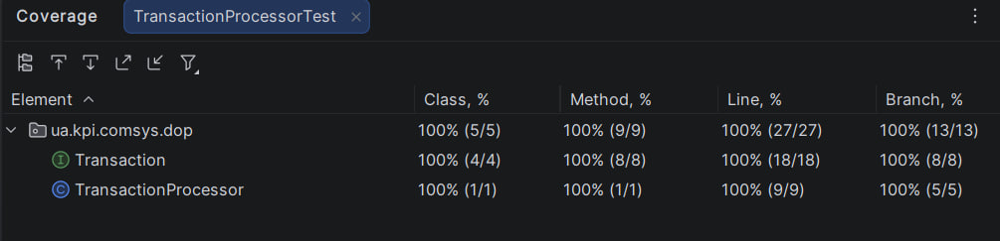
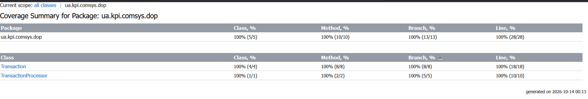

# Лабораторна робота №1 (DOP)
## Опис проєкту

Реалізовано фінансову систему транзакцій.
Принцип [DOP](https://en.wikipedia.org/wiki/Data-oriented_design) реалізовано через `sealed interface Transaction` та типи `record` (`Deposit`, `Withdrawal`, `Transfer`). У конструкторах кожної моделі додано перевірку параметрів: `amount` не може бути `null` або `<= 0`, а текстові поля (рахунки, категорія) не можуть бути `null` чи порожніми. У разі порушення кидається `IllegalArgumentException`.
Розроблено клас `TransactionProcessor` для обробки транзакцій. Він використовує `switch expression` з `pattern matching` (без `default`) для обробки всіх типів транзакцій і повертає відформатований текст через `Text Blocks`. Для `null` метод кидає `IllegalArgumentException("Transaction cannot be null")`.
Також написано юніт-тести на `JUnit 5`, які перевіряють усі гілки `switch`, а також усі виняткові ситуації та валідацію в конструкторах.

Усі класи знаходяться в пакеті `ua.kpi.comsys.dop`.

## Розрахунок варіанта

$$V = 4 \bmod 3 = 1$$

**Варіант $V = 1$:** Фінансова система транзакцій

## Інструкція із запуску тестів
> Для збірки проєкту та виконання тестів потрібні JDK 21+ та IntelliJ IDEA Coverage

Запуск тестів в IntelliJ IDEA: ПКМ по `src/test/java` → **Run 'All Tests'**.

Також тести можна запустити через Maven:

```bash
mvn test
```

Результат на скріншоті знизу:



## Покриття тестами



Покриття коду тестами ( за звітом IntelliJ IDEA Coverage):
- **Class:** 100%
- **Method:** 100%
- **Branch:** 100%
- **Line:** 100%

Щоб отримати звіт у IntelliJ IDEA, потрібно:
1. ПКМ по `src/test/java` (або по класу `TransactionProcessorTest`) → **Run with Coverage**.
2. У вікні **Coverage** з'являться відсотки покриття по класах.
3. Натисніть **Generate Coverage Report**, щоб зберегти HTML-звіт та перейти до перегляду у браузері.